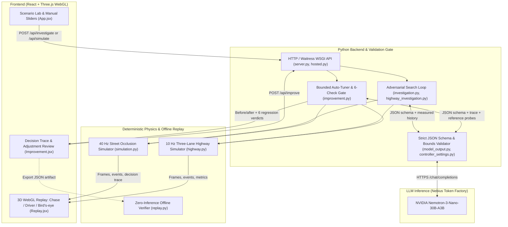
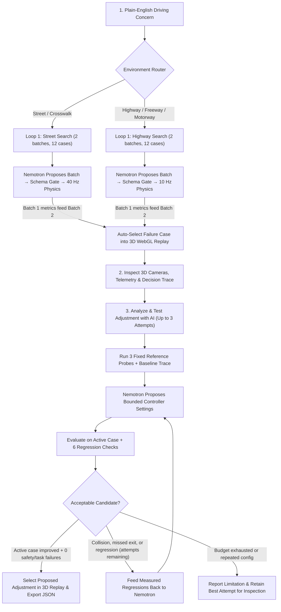

# BlindSpot

A closed-loop AI + physics workspace for reproducing autonomous-driving takeover edge cases (*"why didn't the controller anticipate what a human driver would?"*), inspecting deterministic telemetry in 3D, and validating AI-proposed controller adjustments across **Street** and **Highway** environments.

| Environment | Scenario inputs varied | Baseline controllers | Tunable adjustment settings |
| --- | --- | --- | --- |
| **Street** (40 Hz) | Vehicle speed, van gap, pedestrian presence, start timing, walk speed, reaction delay, braking strength | Reactive vs. occlusion-aware | Slowing distance, caution speed factor, conflict braking margin |
| **Highway** (10 Hz) | Target speed (mph), traffic speed & wave swing, spacing, exit distance (`0–1.0 mi`), aggressiveness, phase | Aggressive vs. exit-aware | Exit preparation distance, lane-change cooldown, required speed benefit |

## Architecture

BlindSpot enforces a strict boundary between **probabilistic AI hypotheses** and **deterministic physics evaluation**. NVIDIA Nemotron proposes JSON-schema-bounded scenarios and controller parameters—never executable code and never safety verdicts.



## Closed-Loop Workflow



## How it works

1. **Generate & replay with AI**: Enter a driving concern and submit. Mentioning `highway`, `freeway`, `interstate`, or `motorway` selects Highway; other prompts use Street. NVIDIA Nemotron (via Nebius Token Factory) proposes bounded scenarios in batches (~5s for 12 scenarios), receives measured simulator outcomes from both controllers, and refines the next batch. A discovered failure case automatically loads into the 3D Three.js replay.
2. **Inspect & compare**: Switch between **Chase**, **Driver**, **Bird’s-eye**, and **2D map** views, toggle controllers on identical traffic/pedestrian trajectories, or run non-AI **Random**, **Systematic**, **One-variable counterfactual**, and **Independent evaluation** suites without an API key.
3. **Analyze & test adjustment with AI**: On any loaded case, the server sends measured baseline metrics, events, Street decision traces, and three fixed simulator reference probes to Nemotron (up to 3 requests). Each valid JSON setting proposal is evaluated against the original controller on the active case plus 6 synthetic regression checks; an accepted candidate automatically plays as **Proposed adjustment** in the 3D viewport.
4. **Export & reproduce**: Export cases, runs, or adjustment reports to JSON and recompute them offline without inference.

## Quickstart

Requires Python 3.9+, Node.js 22.12+, and npm.

```sh
npm ci --prefix frontend
npm run build --prefix frontend
python3 server.py
```

Open `http://127.0.0.1:8765` (use `--port 8766` if occupied). For frontend hot-reload, run `python3 server.py --port 8766` alongside `npm run dev --prefix frontend`.

### Connect live NVIDIA Nemotron (optional)

Copy `.env.example` to `.env.local`, set `NEBIUS_TOKEN_FACTORY_KEY` (and optionally `NEBIUS_MODEL`), and restart `server.py`. Live AI calls `https://api.tokenfactory.nebius.com/v1` and consumes Nebius credits; missing credentials or network errors fail explicitly rather than fabricating AI output. All model outputs are validated strictly as bounded data—never executed as code.

## Verify & replay

```sh
python3 -m unittest -v
npm test --prefix frontend
npm run build --prefix frontend

# Recompute exported cases or adjustment reports offline
python3 replay.py examples/default-case.json
python3 replay.py examples/live-highway-production-20261030.json
python3 benchmark.py
```

## Scope & docs

BlindSpot uses simplified 2D geometry rendered in stylized 3D, idealized line-of-sight sensing, exogenous background actors, and internal rule-based controllers. It is an engineering exploration workspace—not external vehicle software (such as Tesla FSD) and not real-world safety validation.

- [Verification history & live test logs](VALIDATION.md)
- [Offline search benchmark audit](BENCHMARK.md)
- [Hosted deployment guide (Render / Docker)](DEPLOYMENT.md)

MIT licensed. Not affiliated with or endorsed by NVIDIA, Nebius, or any autonomous-vehicle company.
